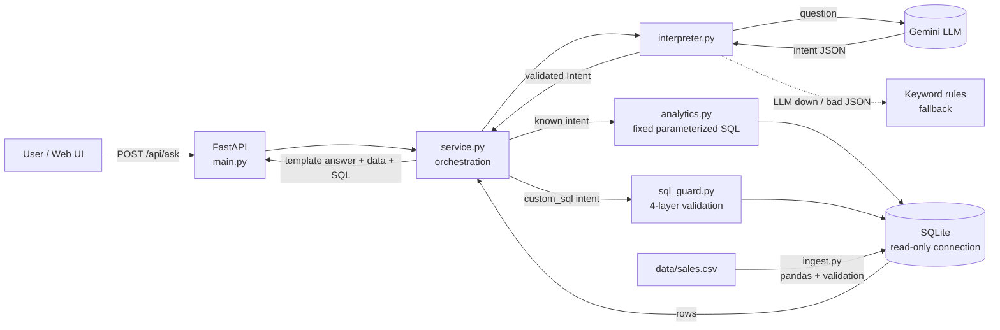

# Mini AI Business Intelligence Assistant

Ask questions about sales data in plain English, such as *"Which region generated the highest sales?"*, and get an answer **computed by a database query**, along with the figures and the SQL that produced it.

**Core design rule:** the AI only works out *what the question means*. It never produces the numbers. Every figure comes from a parameterized SQL query, and the answer sentence is filled in from the query results.

---

## 1. Setup and run

Requires **Python 3.11+**.

```bash
git clone https://github.com/sreeja-dende/RSG-assessment.git
cd RSG-assessment
python -m venv .venv
# Windows:  .venv\Scripts\activate        Mac/Linux:  source .venv/bin/activate
pip install -r requirements.txt
```

**Configure the AI (optional).** Without this, the app runs in keyword-rules mode with no API key.
```bash
copy .env.example .env        # Mac/Linux: cp .env.example .env
# edit .env:  LLM_PROVIDER=gemini   and   GEMINI_API_KEY=<your key from aistudio.google.com>
```

**Run:**
```bash
python -m uvicorn app.main:app --reload
```
| Open | What it is |
|---|---|
| http://127.0.0.1:8000/ | Web UI: ask questions, see answer + supporting data + SQL |
| http://127.0.0.1:8000/docs | Interactive API docs (Swagger) |
| http://127.0.0.1:8000/api/data-quality | Rows rejected during loading, and why |

The database is rebuilt from `data/sales.csv` on every start. To load it manually: `python -m app.ingest`

**Run the tests:**
```bash
pytest -v
```

---

## 2. Architecture



**Request flow:**
1. **Interpret.** The LLM turns the question into an `Intent` JSON object (for example `{"type": "revenue_by", "dimension": "region"}`). If no LLM is configured, or it fails or returns invalid JSON, keyword rules produce the same `Intent` instead.
2. **Validate.** Pydantic checks the intent's shape. Every product, region and month is checked against the values actually in the database. Unknown values are refused, never guessed.
3. **Query.** Each intent type maps to one fixed, parameterized SQL query.
4. **Answer.** A template builds the sentence from the query result. The response includes the supporting rows, the exact SQL and parameters, and any warnings.

| File | Responsibility |
|---|---|
| `app/ingest.py` | Load the CSV with pandas, validate each row, store valid rows, log rejected ones |
| `app/db.py` | Schema (tables, indexes, revenue view), read-only connections |
| `app/schemas.py` | Pydantic models: `Intent` (the AI↔DB contract), request and response |
| `app/interpreter.py` | LLM interpretation, keyword-rule fallback, validation against real data |
| `app/analytics.py` | Fixed SQL per question type, plus a column whitelist |
| `app/sql_guard.py` | Validation and sandboxed execution of LLM-written SQL |
| `app/service.py` | Ties everything together and builds the answer text |
| `app/llm.py` | Provider wrapper: timeout, retry with backoff, API key sent in a header |
| `app/main.py` | API routes, error handlers, serves the UI |
| `app/static/index.html` | Simple UI (plain HTML/JS, no framework) |

---

## 3. Data: how it is stored and queried

**Tables (SQLite, `data/sales.db`):**

| Object | Purpose |
|---|---|
| `sales` (table) | One row per valid transaction. Dates stored as ISO `YYYY-MM-DD`. `CHECK` constraints enforce quantity > 0, price > 0, discount ≥ 0. Indexed on date, product and region. |
| `rejected_rows` (table) | Every row that failed validation: the CSV line number, the original data as JSON, and the reason. Nothing is silently dropped. |
| `revenue_lines` (view) | **The single definition of revenue:** Completed orders only, `net_revenue = quantity × unit_price − discount_amount`, plus a `month` column. All queries read from this view. |

**Validation and handling of the supplied data:**

| Issue in the CSV | Handling |
|---|---|
| Dates are `DD-MM-YYYY` (`03-01-2026` = 3 Jan) | Parsed with an explicit format. A default parser could read it as 1 March. |
| TXN0033 has status **Returned** | Stored, because it is real data, but excluded from revenue by the view |
| TXN0034 has **quantity 0** on a Completed order | Rejected: quantity must be > 0 |
| TXN0051 has a **missing unit price** | Rejected: revenue cannot be computed. **Not imputed**, because filling in ₹1,200 from other rows would be inventing data. |
| Windows line endings, stray spaces | Handled by pandas and `strip()` |

Other rules: duplicate IDs, unparseable numbers, negative discounts, and discounts larger than the order value are rejected. A blank discount is treated as 0. The CSV is read **as text first** (`dtype=str`), so our rules decide validity rather than pandas' automatic type conversion. The whole load runs in **one transaction**.

**Result:** 51 rows → 49 stored (48 Completed + 1 Returned), 2 rejected. Total revenue **₹14,39,200**.

---

## 4. AI integration and how wrong answers are prevented

| Risk | Prevention |
|---|---|
| LLM invents numbers | The LLM never outputs numbers. It only chooses the query type and parameters. All figures come from SQL, and the answer text is a template. |
| LLM returns malformed or unexpected output | JSON mode plus Pydantic validation (allowed intent types, `YYYY-MM` months). On any failure, the keyword rules answer instead and a warning is shown. |
| LLM picks a product or region that doesn't exist | Checked against the real distinct values in the database. Unknown → "not a known product", never silently ignored. |
| Unknown name ignored, giving the wrong total | The rules detect unrecognised names ("revenue for Tablets") and refuse instead of returning the overall total. |
| Question needs data we don't have | Profit, cost, customers and forecasts get an explicit refusal with the reason. |
| SQL injection | Values are always passed as `?` parameters. Column names come only from a fixed whitelist. |
| Destructive SQL from text-to-SQL | 4 layers in `sql_guard.py`: (1) one SELECT/WITH statement, no comments, no write keywords; (2) a **SQLite authorizer** that denies any action except reading `sales` / `revenue_lines`; (3) a **read-only** connection (`mode=ro`); (4) a 200-row cap and a query work limit. |
| Silent assumptions | Every answer lists its assumptions as warnings: returned and invalid rows excluded, which months were compared when none were given, months with no data. |
| API key leakage | The key is sent in an HTTP header, not the URL, so it never appears in logs. `.env` is git-ignored. |

**Text-to-SQL** is used only when a question is answerable but fits none of the 4 built-in types (for example "average units per order by channel"). The UI then shows a warning and the SQL, so the user can check it.

---

## 5. API

| Method | Path | Description |
|---|---|---|
| POST | `/api/ask` | Body `{"question": "..."}` (3–500 chars). Returns `status` (`answered`/`unsupported`), `answer`, `intent`, `interpreted_by` (`llm`/`rules`), `supporting_data` (`columns`, `rows`, `sql`, `params`) and `warnings`. |
| GET | `/api/data-quality` | Loaded/rejected counts, status breakdown, rejected rows with reasons |
| GET | `/api/examples` | Example questions |
| GET | `/health` | Liveness check plus row count |

Errors are always JSON: `422 invalid_request` (empty, missing or too-long question, or malformed JSON), `503 data_unavailable` (no database), `500 internal_error` (with no stack trace exposed). Unsupported questions return `200` with `status: "unsupported"`, since the request was valid and the answer is "I can't answer that".

**Example:**
```json
POST /api/ask  {"question": "Which region generated the highest sales?"}
→ {
  "status": "answered",
  "answer": "The region with the highest revenue is South: ₹4,11,200 (28.6% of the total).",
  "intent": {"type": "revenue_by", "dimension": "region", "order": "desc", ...},
  "interpreted_by": "llm",
  "supporting_data": {"columns": ["region", "revenue", "orders"],
                      "rows": [["South", 411200.0, 13], ["North", 384450.0, 14], ...],
                      "sql": "SELECT region, ROUND(SUM(net_revenue), 2) AS revenue ...", "params": []},
  "warnings": ["Revenue counts completed orders only, net of discounts. Excluded: 1 non-completed order(s) and 2 invalid CSV row(s) ..."]
}
```

---

## 6. What works / what doesn't

| Feature | Status |
|---|---|
| All 5 example questions (total, top product, monthly trend, top region, month comparison) | ✅ Works |
| Filters (region, product, category, channel, month) and lowest/highest, units vs revenue | ✅ Works |
| LLM interpretation (Gemini) with automatic rule fallback | ✅ Works |
| Guarded text-to-SQL for other questions | ✅ Works (LLM mode only) |
| Data validation, rejected-row log, data-quality endpoint | ✅ Works |
| Web UI with supporting data, SQL view and bar visualisation | ✅ Works |
| Automated tests | ✅ 70 tests |

## 7. Testing

`pytest -v` runs 70 tests in about 2 seconds, offline. The LLM is replaced by a fake function, so tests are free and repeatable. Expected figures were calculated independently with pandas.

| File | Covers |
|---|---|
| `tests/test_ingest.py` | Supplied CSV: 49 loaded, 2 rejected with correct reasons; day-first dates; returned orders excluded; 10 invalid-row cases; duplicates; missing columns |
| `tests/test_questions.py` | **Valid:** all 5 assignment questions with exact figures, filters, lowest, units. **Invalid:** profit, weather, delete, unknown product, customers, and 422 requests. **Edge cases:** compare with no month / one month / a month without data, filters with zero matches, disclosure of excluded rows |
| `tests/test_ai_safety.py` | LLM intent used; invalid LLM output (prose with invented numbers, bad type, bad month, provider down) falls back to rules; unknown LLM values refused; text-to-SQL SELECT runs; 11 destructive or unsafe SQL attempts blocked; data intact after an attack; currency formatting |

## 8. Known limitations

- **Keyword rules** (used when no LLM is configured) understand common phrasings only. Unusual wording may be refused. LLM mode handles phrasing far better.
- **The missing-price row is excluded, not imputed.** Its revenue (≈₹6,000 if the usual ₹1,200 price applied) is not counted.
- **Months with no sales** don't appear in the trend table (there are no gaps in this data).
- **Text-to-SQL answers** show the raw table plus a generic sentence, not a tailored explanation.
- **Single CSV, single user.** There is no upload endpoint, authentication or caching. SQLite suits this size, and Postgres would be the next step for concurrent use.
- **Revenue is net of discount and excludes returns.** That is a stated business assumption. Gross revenue is available in the view (`gross_revenue`).
- One question is answered at a time, with no conversation memory ("and in May?" does not work).

## 9. Assessment documents

- **[AI_USAGE.md](AI_USAGE.md):** AI tools used, how they were used, problems encountered, debugging, and improvements for another day.
